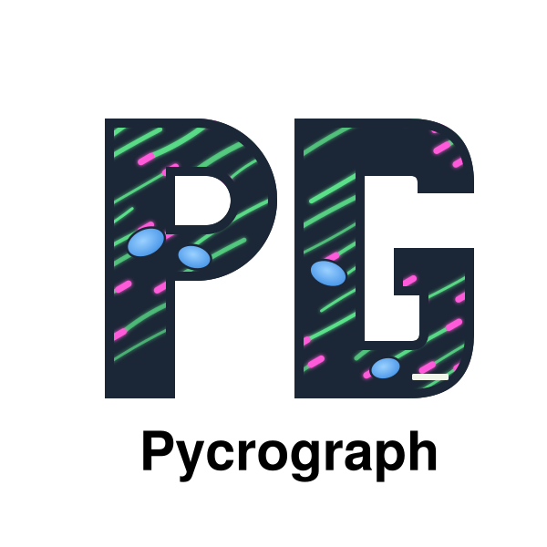

<p align="center">
  
</p>

# Pycrograph

**Publication figures from fluorescence microscopy images — non-destructive and provenance-tracked.**

[](https://doi.org/10.5281/zenodo.24404763)
[](https://www.gnu.org/licenses/gpl-3.0)
[](https://www.python.org)
[](https://github.com/TheBrickalista/Pycrograph/releases)
[](https://github.com/TheBrickalista/Pycrograph/releases)
[](https://pycrograph.readthedocs.io/en/latest/)
[](https://github.com/TheBrickalista/Pycrograph/actions/workflows/pytest.yml)

→ **[Quick Start](QUICKSTART.md)** — get up and running in a few minutes  
→ **[Documentation](https://pycrograph.readthedocs.io)** — installation, user guide and concepts  
→ **[Download](https://github.com/TheBrickalista/Pycrograph/releases)** — macOS and Windows apps (newest *Pre-release*), no Python needed

Pycrograph is the imaging sister of [PysternBlot](https://github.com/TheBrickalista/PysternBlot)
(Western blot figures). It keeps what OMERO.figure does well — figures re-rendered
from raw data with recorded display settings — without a server.

> **Status: beta (0.2.0).** 0.x releases are betas: GitHub pre-releases,
> each archived on Zenodo with a DOI. 1.0.0 will be the first stable
> release, also published on PyPI.
> Library, TIFF-family readers (plain, ImageJ, MetaMorph TIFF/STK), the
> per-channel display pipeline, the figure
> editor (layout, labels, scale bars, insets, shapes), consistency check,
> provenance-tracked export and `.pcarchive` archives work (see
> [Roadmap](Roadmap.md)).

## Principles

- **Figures only.** No segmentation, measurements or intensity statistics.
- **Raw pixels are never modified.** Levels, gamma, LUTs, rotation and flips
  are display settings re-applied at every render.
- **Local only.** No server, no database, no network.
- **Provenance as in PysternBlot.** SHA-256 of every source file, hash-chained
  operation log, integrity report; 8-bit sources flagged, JPEG rejected,
  non-linear gamma flagged.
- **Big files, small laptop.** Images are registered *by reference* (not copied)
  and read one plane at a time, so a 1 GB time-lapse opens on an 8 GB Mac.

## What works now

- Projects › Datasets › Images (OMERO-style virtual tree; one file can sit in
  several datasets), tags, key–value pairs, ratings, search.
- TIFF: plain, ImageJ (hyperstacks) and multi-page, with multi-T / multi-Z /
  interleaved channels. MetaMorph TIFF and STK are the formats whose metadata
  is read in full: pixel size, illumination, wavelength, objective/NA,
  exposure, acquisition time, and Z vs T of the planes.
- Background SHA-256; missing/changed/modified detection; hash-verified relink,
  including "drive was remounted as `/Volumes/LaCie 1`" for all images at once.
- Per channel: on/off, LUT (named or custom colour), histogram with draggable
  gates, Black/White typed or dragged, gamma, invert, saturation badge,
  free-text stain/antibody. T/Z navigation, 90° rotation, flips.
- Integrity report (JSON).

## Install

| Platform | Download | Notes |
|---|---|---|
| **macOS** | `Pycrograph-vX.Y.Z-macOS.zip` from the [Releases page](https://github.com/TheBrickalista/Pycrograph/releases) (newest *Pre-release*) | macOS 15 or later, Apple Silicon. Signed and notarized: unzip, move to Applications, open. |
| **Windows** | `Pycrograph-vX.Y.Z-Windows.exe` from the [Releases page](https://github.com/TheBrickalista/Pycrograph/releases) (newest *Pre-release*) | Not yet code-signed: Windows SmartScreen shows a warning on first run — click **More info → Run anyway**. |
| **Python (any OS)** | From source (see [Installation](https://pycrograph.readthedocs.io/en/latest/installation.html)); `pip install pycrograph` from 1.0.0 | Python 3.11 or later; also for Intel Macs (macOS 15 or later). |

macOS versions before 15 are not supported (PySide6 6.11's binding modules
require macOS 15). Betas (all 0.x versions, e.g. `0.2.0`, `0.2.0b1`) are
published as GitHub pre-releases with signed apps and archived on Zenodo, not
on PyPI. Full documentation:
<https://pycrograph.readthedocs.io>.

### Development

```bash
git clone https://github.com/TheBrickalista/Pycrograph.git
cd Pycrograph
uv sync --extra dev        # or: pip install -e ".[dev]"
uv run python -m pycrograph
```

Python ≥ 3.11. The workspace lives in `~/.pycrograph` (override with
`PYCROGRAPH_WORKSPACE`).

## Tests

```bash
uv run pytest
# with the real reference image:
PYCROGRAPH_SAMPLE_TIFF="/Volumes/LaCie/…/Nuc_ER_ER.tif" uv run pytest -m sample
```

## Citing

If you use Pycrograph in published work, please cite it:

> Boulter E, Féral CC (2026). Pycrograph [Computer software].
> https://doi.org/10.5281/zenodo.24404763

This is the Zenodo **concept DOI**: it always resolves to the latest version.
Each release also has its own version DOI on Zenodo, so you can cite the exact
version you used. The citation metadata is in [`CITATION.cff`](CITATION.cff); GitHub
renders it through **Cite this repository**.

## License

GPL-3.0-only. Copyright © 2026 Etienne Boulter, Chloé C. Féral — Université Côte d'Azur, CNRS,
Inserm, IRCAN.
