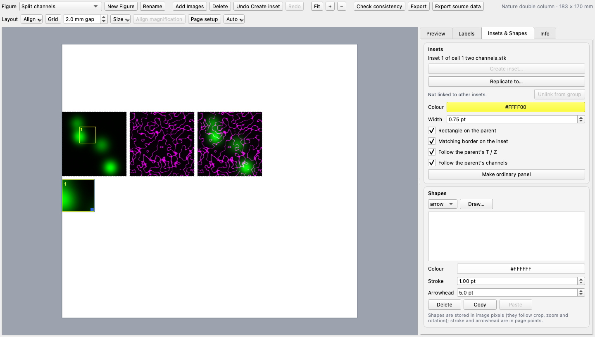
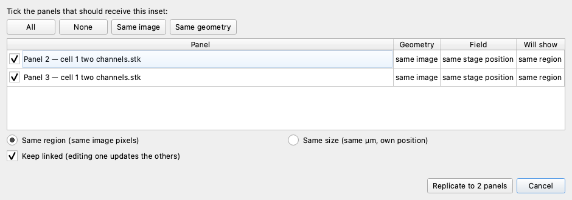
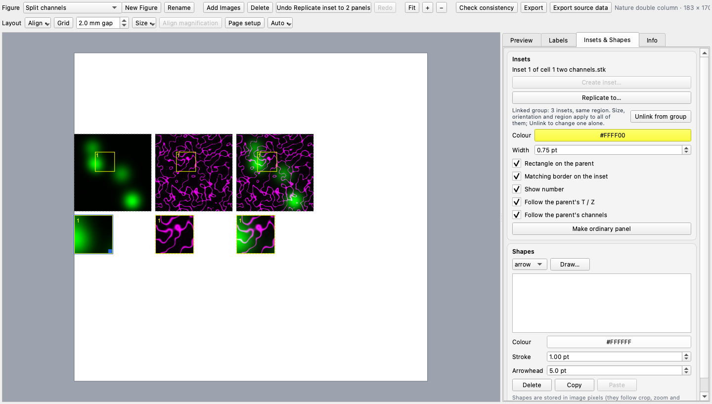
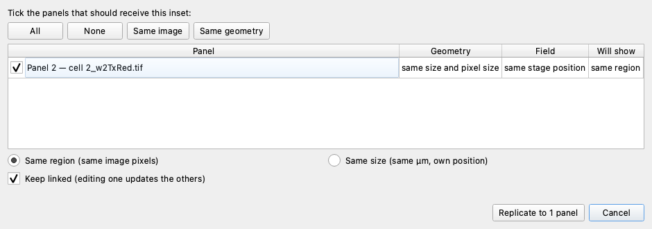
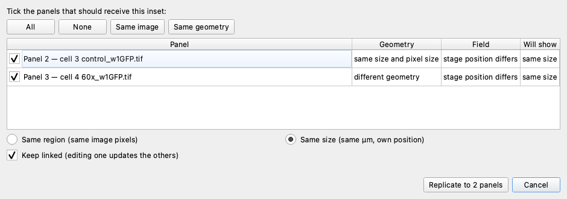

# Insets, step by step

An **inset** is a magnified view of one region of a panel. Pycrograph shows
it as its own panel, numbered and coloured to match the rectangle drawn on
the panel it comes from (its **parent**). This page walks through making an
inset, repeating it on other panels, and keeping the copies in step. For the
rules behind it, see {doc}`../concepts/locks-and-insets`.

Everything below happens in the **Figures** tab, in the **Insets & Shapes**
tab of the inspector on the right.

## 1. Create an inset

### On one panel

1. Click the panel to select it.
2. Click **Create inset…**. The status bar says *Create inset: drag a
   rectangle on the panel (Esc cancels)*.
3. Drag a rectangle around the structure you want to show.

A new panel appears at **twice the parent's magnification**: to the right of
the parent, or **directly below it** when the parent is part of a row (split
channels, a row of conditions) and there is room, so the row stays a row.
The status bar says *Inset created — use Replicate to… to repeat it on other
panels*. Both get the same number and colour: the rectangle
on the parent and the border of the inset. The first inset of a panel is
yellow, then cyan, magenta, green, orange and white.



The inset stays tied to its parent:

- **Drag or resize the rectangle on the parent** (with the parent selected)
  and the inset shows the new region.
- **Pan or zoom the inset** (Preview tab, viewport) and the rectangle on the
  parent follows.
- With **Follow the parent's T / Z** and **Follow the parent's channels**
  ticked (the default), the inset changes time point, Z plane, levels and LUTs
  with its parent.

**Scale bar.** A new inset starts **without a scale bar**, even when its
parent shows one: the magnification is usually stated by the parent's bar or
in the legend. If the journal asks for a bar on the inset too, select it and
tick **Show scale bar** in the **Labels** tab. The bar is already set to the
parent's length, unit, colour and position, drawn at the inset's
magnification. **Check consistency** warns if it is longer than the inset
(*scale bar longer than the panel*). It doesn't flag an inset without a bar
next to a parent that has one, but it does flag a row of insets where only
some show a bar.

The same tab sets the inset's style: **Colour**, line **Width**,
*Rectangle on the parent*, *Matching border on the inset* and **Show
number**. Untick *Show number* to hide the number on the inset and next to
its rectangle on the parent; colours, border and rectangle stay. A label in
the inset's top-left corner then moves up into the freed space. These style
options apply to every selected inset in one step, and are per inset: they are
not shared through a linked group (see section 4).

### On several panels at once

1. Select all the panels that should get the inset (Ctrl/Cmd-click). The
   button now reads **Create inset… (then offer it on N other panels)**.
2. Click it and draw the rectangle on **one** of them.
3. The **Replicate inset** dialog opens with the other panels already ticked.
   Continue with step 2 below.

## 2. Replicate an inset

*Replicate to…* puts **the same inset** on other panels: same region (or
same physical size), same magnification, colour, width, follow options and
**scale bar** (shown or not, as on the inset you replicate, whatever bar the
other parents show).

1. Select **the inset**. Selecting its parent also works if that panel has
   only one inset.
2. Click **Replicate to…**. The dialog lists **every panel of the figure that
   can receive the inset**, each with a checkbox. The parent's split or lock
   group comes first, then the other panels in figure order.
3. **Tick the panels** that should get the inset. Some are already ticked:
   - the panels you had selected together with the inset (Ctrl/Cmd-click
     them before clicking *Replicate to…*);
   - otherwise, the parent's split or lock group;
   - otherwise, none.

   **All**, **None**, **Same image** and **Same geometry** tick several
   panels at once. *Same geometry* means the same width × height and pixel
   size, and includes the same image.
4. Check the mode (**Same region** or **Same size**, see below) and
   **Keep linked**.
5. Click **Replicate to N panels**. The button is greyed out while nothing is
   ticked.



Each copy is placed **directly below its own parent**, at the same distance
and left alignment as the original, when the original sits below its parent
or the parents form a row. Otherwise it goes at the same offset from its
parent as the original. If that spot is taken or off the page, it goes to
the nearest free place.

### What the table columns mean

| Column | What it tells you |
|---|---|
| **Panel** | The panel that will receive the inset (its number on the page and its file). |
| **Geometry** | How its image compares with the inset's image. *same image*: the same file, for example another channel of it. *same size and pixel size*: another file with identical width × height and µm per pixel. *different geometry*: another size or pixel size, for example another objective. |
| **Field** | Whether the microscope stage was at the same place for both images (read from MetaMorph metadata): *same stage position*, *stage position differs*, or *stage position unknown* when the file doesn't record it. |
| **Will show** | What that panel will actually get: *same region*, *same size*, or *same size (fallback: different geometry)*. An em dash (—) means the panel is not ticked. |

### Same region or Same size?

- **Same region** shows **exactly the same pixels**, the same rectangle in
  raw image coordinates, in every panel. Use it when the images show **the
  same field of view**: the channels of one file, or separate files taken one
  after the other without moving the stage.
- **Same size** shows a region of the **same physical size (µm)** in every
  panel, starting at the same relative place, and each inset can then be moved
  on its own. Use it for **different cells, conditions or objectives**, where
  the same pixels would show unrelated things.

Same region is only possible between images of the same geometry. For a panel
with *different geometry*, Pycrograph uses Same size instead, and the
*Will show* column says so.

**Pycrograph chooses for you.** The dialog selects **Same region** only when
every ticked panel shows the same image, or an image of the same geometry
taken at the **same stage position**. In every other case it selects
**Same size**. The choice updates as you tick and untick panels. Once you
click one of the two options yourself, your choice is kept.

### The registration warning

> *Same region assumes the images are registered (same field).*

This orange line appears when Same region is selected for a ticked panel from
**another file** whose stage position is not confirmed to be the same
(*differs* or *unknown*). Pycrograph never selects that by default: you see it
only after choosing Same region yourself. Pycrograph will do what you ask, but the "same"
rectangle may then show a different part of the cell. If the images really
are different fields, choose **Same size**.

### Keep linked

With **Keep linked** ticked (the default), the original inset and its copies
form a **linked group** that behaves as **one inset repeated**: change one and
the others follow (see section 4). Untick it to get independent copies that
you can change one by one.

## 3. Three worked cases

### (a) Split channels of one multichannel file

1. Add the image (**Add Images…**), select its panel, and choose
   **Auto ▾ → Split channels**. You get one panel per channel plus the merge,
   locked together.
2. Select the first channel panel, click **Create inset…** and draw the
   rectangle.
3. With the new inset selected, click **Replicate to…**. The other panels of
   the split row are already ticked. The table shows *same image* and *same
   stage position*, so **Same region** is selected.
4. Keep **Keep linked** and click **Replicate to 2 panels**.

Each copy sits below its own channel, and every channel shows the same
magnified region. Move the rectangle on any
parent and all the insets follow.



### (b) MetaMorph files saved per wavelength (`_w1`, `_w2`…)

MetaMorph often saves each wavelength of one acquisition as its own file,
for example `cell 2_w1GFP.tif` and `cell 2_w2TxRed.tif`. They have the same
size and pixel size, and the same stage position.

1. Add both files (**Add Images…**, Ctrl/Cmd-click both, **Add 2 images**).
2. Create the inset on the `_w1` panel.
3. Select the inset, Ctrl/Cmd-click the `_w2` panel, and click
   **Replicate to…**. The `_w2` panel is already ticked. (You can also tick
   it in the dialog.)
4. The table shows *same size and pixel size* and *same stage position*, so
   **Same region** is selected and there is no warning. Keep **Keep linked**
   and click **Replicate to 1 panel**.



If the Field column says *stage position differs*, the stage moved between
the two files: treat them as in case (c).

### (c) Different cells, conditions, or another objective

Here the images show different fields, so the same pixels would mean nothing.
What you want is **the same magnification and the same physical size**, each
inset framed on its own cell.

1. Create the inset on one cell (for example the control).
2. Select the inset, click **Replicate to…**, and tick the panels of the other
   cells (or Ctrl/Cmd-click them before opening the dialog).
3. **Same size** is selected for you, because the stage position differs or
   the geometry is different. The table may show:
   - *same size and pixel size*, *stage position differs*: another field
     with the same objective;
   - *different geometry*: another objective or camera binning.
4. Click **Replicate to N panels**.
5. **Move each inset** onto its own structure: select its parent and drag the
   rectangle, or pan the inset in the Preview tab. With Same size, moving one
   inset never moves the others. Changing the **size** of one still changes
   all of them, so they stay comparable.



Because all copies share the same physical magnification (µm per page-mm),
equal scale bars look equal across the insets.

## 4. Working with a linked group

Select an inset of a group: the Insets & Shapes tab says *Linked group …: N
insets, same region / same size*.

**What propagates to every inset of the group**, in one step:

- panning and zooming in the Preview tab's viewport;
- dragging or resizing the rectangle on a parent;
- resizing the inset on the page, **Size ▾ → Same width / Same height**, and
  **Align magnification**;
- rotation and flips;
- pasting a viewport.

The status bar confirms it: *applies to the N linked insets*. With Same size
members, panning moves only the inset you touched. Its size and zoom still
propagate.

**What stays per inset**:

- its **position on the page**;
- for Same size members, **where** on its own image it looks;
- its colour, line width, *Show number*, scale bar and follow options. To
  change these for the whole group, select all its insets together first.

**Unlink from group** (Insets & Shapes tab) takes the selected insets out of
the group so you can change one alone. **Make ordinary panel** turns an inset
into a normal panel, which also leaves the group. A group left with a single
inset simply disappears.

**Copy / paste** (Ctrl/Cmd+C, Ctrl/Cmd+V):

- copy a **whole group**: the copies form a new group of their own;
- copy only **part** of a group: the copies are not linked;
- copy a **parent together with its insets**: the copies keep their
  parent–inset link.

**Delete**: deleting an inset takes it out of its group. Deleting a parent
turns its insets into ordinary panels.

**Undo** (Ctrl/Cmd+Z) undoes a change to the whole group in one step, the same
way it was applied. The project log records one entry per inset changed.

## 5. Troubleshooting

### Create inset… is greyed out

- Nothing is selected, or only insets are selected. An inset cannot have its
  own inset: select the original panel.
- A selected panel's image has been removed from the project.

### Replicate to… is greyed out

Hover over the button: its tooltip says why.

- *Select an inset first*: the selection has no inset, and no panel with an
  inset.
- *Select only one inset to replicate*: two or more insets (or two parents
  with insets) are selected. Replicate them one at a time.
- *This panel has N insets: select the one to replicate*: you selected a
  parent with several insets. Click the inset you mean.
- *No other panel in the figure to replicate to*: every other panel is the
  inset's own parent or an inset. Add the panels first (**Add Images…**).

### Replicate to N panels is greyed out

No panel is ticked. Tick at least one, or use **All** / **Same image** /
**Same geometry**.

### A target shows "same size (fallback: different geometry)"

You chose **Same region**, but that panel's image has another width × height
or another pixel size (another objective, binning or crop at acquisition).
The exact same pixels don't exist there, so it gets a region of the same
physical size instead. This is expected. Move that inset onto the right
structure afterwards if needed.

### Same size was selected when I expected Same region

At least one ticked panel is from another file whose stage position differs
or is unknown, or has a different geometry. If you know the images are
registered (the same field), click **Same region** yourself. Otherwise untick
that panel and replicate to it separately with Same size.

### Fewer insets were made than panels listed

The status bar says *Inset replicated to N panels*. If N is smaller than
the number of ticked panels, a panel was skipped because **one image is
spatially calibrated (µm) and the other is not**: a size in µm cannot be
matched to a size in pixels. Check the pixel size in the **Info** tab of both
panels. Use calibrated images, or make that inset by hand with
**Create inset…**.

### The consistency check warns "inset group …: members differ in …"

**Check consistency** (and **Export…**) report a linked group whose insets
are no longer one inset repeated. Pycrograph keeps them identical, so this
usually follows a change made outside the group, such as **Replace image** on
a parent with another size or calibration. The message lists what differs
(panel size or orientation, magnification, region, region size, or a link
that is no longer possible). To fix it, **Undo** the change, or select the
insets that should no longer match, click **Unlink from group**, and
replicate again if needed.

## Regenerating the screenshots

The pictures on this page are made from synthetic images by
`scripts/make_inset_screenshots.py` (offscreen, English number format, no real
data):

```console
$ python scripts/make_inset_screenshots.py
```

Run it again whenever the inset interface changes.
