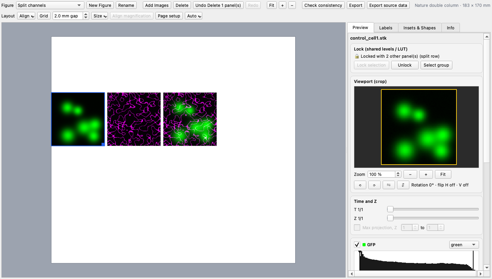
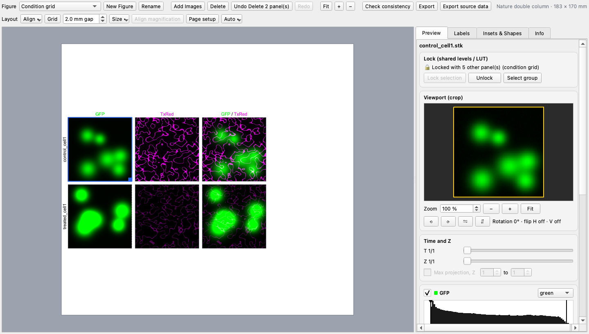
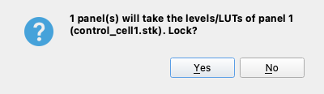
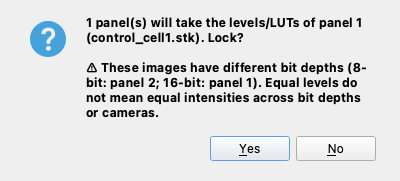
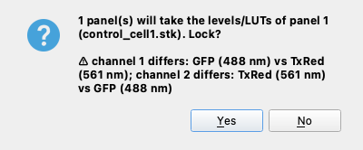
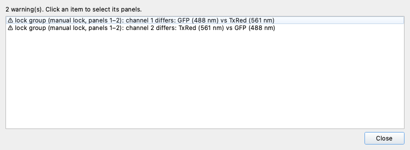

# Locks, step by step

A **lock** makes several panels share their display settings, so that
brightness and colour mean the same thing in every one of them. This page
explains what a lock shares, the locks Pycrograph creates for you, how to lock
panels by hand, and what to do when something looks wrong. For the rules
behind it, see {doc}`../concepts/locks-and-insets`.

Everything below happens in the **Figures** tab, in the **Preview** tab of
the inspector on the right. Its **Lock (shared levels / LUT)** section shows
whether the selected panel is locked and with how many others.

## 1. What a lock is, and why

When you compare a control with a treated cell, the comparison is only fair
if both panels are displayed **the same way**. If the treated panel is
stretched to a brighter display window, a weaker signal can look as strong
as the control's. A lock prevents that: change the levels on one locked
panel and all the others follow.

Display settings never change the raw pixels. They only say how the pixels
are drawn.

**Shared within a lock group, per channel number**:

- **black** and **white** levels (the display window);
- **gamma**;
- **LUT** (the colour);
- **invert**.

"Per channel number" means channel 1 of every panel shares one set of
settings, channel 2 another, and so on. Pycrograph matches channels by their
**position in the file**, not by their name.

**Stays per panel**:

- which channels are visible;
- time point, Z plane and Z projection;
- crop, zoom, rotation and flips;
- labels, scale bar, border, shapes and insets.

## 2. Locks you get automatically

The **Auto ▾** layouts lock the panels they create:

| Layout | Lock created |
|---|---|
| **Split channels** | One group for the row: each channel's panel and the merge. Each panel keeps its own visible channel. |
| **Montage of T or Z…** | One group for all the time points (or Z planes). |
| **Condition grid (shared rendering)…** | **One group for the whole grid.** Every row takes the first row's settings, so all conditions are displayed identically. |
| **Condition grid (keep each image's rendering)…** | **One group per row.** Each image keeps its own settings, shared only across that row's channels and merge. |

Select any of these panels: the Preview tab says, for example,
*🔒 Locked with 2 other panel(s) (split row)*.





Use the **shared rendering** grid when the conditions are to be compared by
intensity. Use **keep each image's rendering** only when each row is shown
for its pattern, not its brightness, and say so in the legend.

## 3. Locking by hand

1. Select the panels that must be shown the same way (Ctrl/Cmd-click, or
   drag a rubber band around them).
2. In the **Preview** tab, click **Lock selection**. The button is greyed out
   until at least two panels are selected.
3. If their settings differ, Pycrograph asks first:

   > *N panel(s) will take the levels/LUTs of panel K (file name). Lock?*

   The reference is the **selected panel that comes first in the figure**
   (the lowest panel number, which the message names). It is not the panel
   you clicked first. Every other panel takes its settings. Click **No** to
   keep things as they are.

   

4. If the panels' channels don't match (for example channel 1 is GFP in one
   file and TxRed in the other), the same message ends with a warning
   (see case (c)). If the images have **different bit depths**, it warns
   about that too, and asks even when the settings are already equal (see
   case (b)). The status bar repeats the warnings after locking.

From then on, any change to black, white, gamma, LUT or invert on one panel of
the group (typing a value, dragging the histogram handles, **Auto**, pasting a
rendering) reaches the same channel of all the others in **one step**. The
status bar says *also applied to N locked panel(s)*.

The other buttons in the Lock section:

- **Unlock** takes the selected panels out of their group. The other members
  stay locked together.
- **Select group** selects every panel of the selected panels' group(s), for
  example to find all members before unlocking them.

Locking panels that already belong to another group moves them into the new
one.

## 4. Worked cases

### (a) Control vs treated, same channel order

Two files acquired with the same settings, channel 1 = GFP and channel 2 =
TxRed in both.

1. Add both images (**Add Images…**) and select both panels.
2. **Lock selection**. Confirm that the treated panel takes the control's
   levels (if the control is panel 1).
3. Set the levels **once** on either panel: the other follows.

Or let **Auto ▾ → Condition grid (shared rendering)…** build the rows and the
lock for you.

### (b) 8-bit and 16-bit images in one group

An 8-bit image's values go from 0 to 255, a 16-bit image's from 0 to 65535.
The same number therefore doesn't mean the same brightness in both, and two
cameras with the same bit depth can differ too. Pycrograph lets you lock them,
but tells you:

- **Lock selection** adds to its confirmation:

  > *⚠ These images have different bit depths (8-bit: panel 2; 16-bit:
  > panel 1). Equal levels do not mean equal intensities across bit depths
  > or cameras.*

  It asks even if the panels' settings are already identical.

  

- A **condition grid** (shared rendering) built from such images shows the
  same warning in the status bar.
- **Check consistency** reports the group: *lock group (manual lock, panels
  1–2): mixes 8-bit and 16-bit images*. Click the line to select the panels.

How values travel inside such a group (unchanged):

- A value is **clamped** to each image's own range. Typing white = 4000 on a
  16-bit panel gives the 8-bit panel white = 255, its maximum.
- **The value you typed stays the reference.** The other 16-bit panels get
  4000, not a clamped copy. Clamping only affects the panels that can't show
  that value.
- Typing on the **8-bit** panel sends its value to everyone: white = 200 on
  the 8-bit panel also gives the 16-bit panels white = 200, which is very
  bright for them.

**What to do:** set the levels on a **16-bit** panel. When locking by hand,
make sure a 16-bit panel comes first in the figure (it is the reference). If
the comparison is about intensity, don't lock across bit depths or cameras:
show them in separate groups and say so in the legend. The provenance sidecar
flags 8-bit sources (`8bit_source`).

### (c) Files whose channel 1 is a different stain

Some files store the stains in another order, for example channel 1 = TxRed
(561 nm) and channel 2 = GFP (488 nm). Because a lock matches channel
**numbers**, locking such a file with a GFP-first file would give TxRed the
GFP settings.

Pycrograph warns you, in the confirmation and in the status bar:

> *⚠ channel 1 differs: GFP (488 nm) vs TxRed (561 nm); channel 2 differs: …*



**What to do:**

- Answer **No** and don't lock these files together. Lock each file with the
  panels that share its channel order instead.
- If you need the two side by side, set their levels by hand to the same
  values per **stain** (copy the numbers from one panel to the other), and
  mention it in the legend.
- If you did lock them, select the panels and click **Unlock**, or **Undo**.

If the names differ only in spelling but it really is the same stain (for
example "GFP" and "EGFP" at 488 nm), the warning is harmless and you can lock.

## 5. Locks, inset links and "Follow the parent's channels"

Three features share something between panels. They are independent:

| Feature | Shares | Between |
|---|---|---|
| **Lock** | Black, white, gamma, LUT, invert per channel number | The panels of a lock group |
| **Linked inset group** (Replicate to… → Keep linked) | The inset's size, orientation and region | The insets of a group, see {doc}`insets` |
| **Follow the parent's channels** (inset option) | All channel settings, including visibility | One inset and its parent |

An inset is never part of a lock group itself. With *Follow the parent's
channels* ticked, it copies its parent's rendering every time the parent
changes. If the parent is locked, the inset therefore ends up with the
group's settings too.

## 6. Integrity: the check and the sidecar

**Check consistency** (and **Export…**, which runs it first) looks at every
row, every column and every lock group of the figure:

- **levels**: the same visible channel shown with different black, white,
  gamma, LUT or invert in one row, column or group. Inside a lock group this
  can't happen through editing, so the warning usually means a row or column
  you meant to compare isn't locked. Lock it.
- **channels**: the same channel number is a different stain in one row,
  column or group (case (c)).
- **bit_depth**: a lock group mixes images of different bit depths
  (case (b)).

A lock group is named by its kind and its panels, never by an internal code:



Each export writes a **provenance sidecar** (a JSON file next to the figure).
For every panel it records:

- `lock_group` (an identifier shared by the group's members) and `lock_kind`
  (*split row*, *montage*, *condition grid* or *manual lock*);
- `channels`: for each channel, the exact black, white, gamma, LUT, invert
  and visibility used, with the channel name and wavelength;
- `flags`, such as `nonlinear_gamma` (gamma ≠ 1) and `8bit_source`.

Anyone can therefore verify afterwards that the compared panels used the same
display settings.

## 7. Troubleshooting

### The levels changed on another panel

That panel is locked with the one you edited. The status bar said *also
applied to N locked panel(s)*. Check the Lock line in the Preview tab. Use
**Undo** to go back. Use **Unlock** if that panel should be set on its own.

### Lock selection is greyed out

Fewer than two panels are selected. Select at least two.
(**Unlock** and **Select group** are greyed out when no selected panel is
locked.)

### A panel didn't follow (a panel was skipped)

A lock only reaches panels **whose image has that channel**. A one-channel
image locked with two-channel images can't take changes to channel 2. The
status bar names the panels that were skipped:

> *Channel 2 white: Channel 2 applied to 1 locked panel(s); 1 skipped (no
> channel 2: panel 3)*

Nothing is changed (or logged) on a skipped panel. This is expected. If you
edited several selected panels at once and one of them lacks the channel, the
status bar says *N panel(s) skipped (no channel 2)*.

### Undo

Every lock action is **one undo step**: Lock selection, Unlock, and each edit
that reached the whole group. Ctrl/Cmd+Z restores every panel it changed at
once. The project log records one entry per panel changed.

## Regenerating the screenshots

The pictures on this page are made from synthetic images by
`scripts/make_lock_screenshots.py` (offscreen, English number format, no real
data):

```console
$ python scripts/make_lock_screenshots.py
```

Run it again whenever the lock interface changes.
